# Wukong Codex Theme

## v0.18.7：额度提示与输入框的接缝轮廓

2026-10-23，用户明确授权发布 v0.18.7。运行时 **v116-quota-seam-contour** 针对默认多行输入框上方的额度提示卡，统一两者的圆角来源。原生提示卡固定使用 28px 圆角，Windows 输入框当前使用 `--composer-radius`（22px）；本轮让独立提示卡跟随该输入框的圆角与曲线变量，保留卡片原生底色、宽度、间距、文字和按钮。嵌入输入表面、弹层、摘要面板及其他输入布局不参与该规则。

用户指出的是提示框底部与输入框的接缝错位；排查期间额度已重置，无法再次显示原始业务状态。当前原生组件与 CSS 的独立重现能确认圆角差异，**没有重现截图中的额外深色底板，因此不将本轮轮廓适配写成该底板根因已修复或实机验收通过**。原生来源为 Windows Codex 26.1016.6573.0，完整技术检查与边界见 [验证记录](docs/VALIDATION.md)。

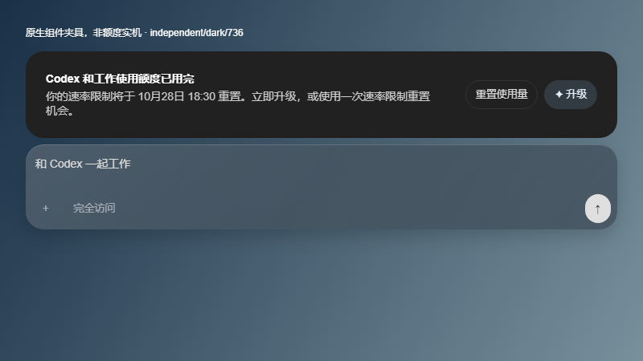

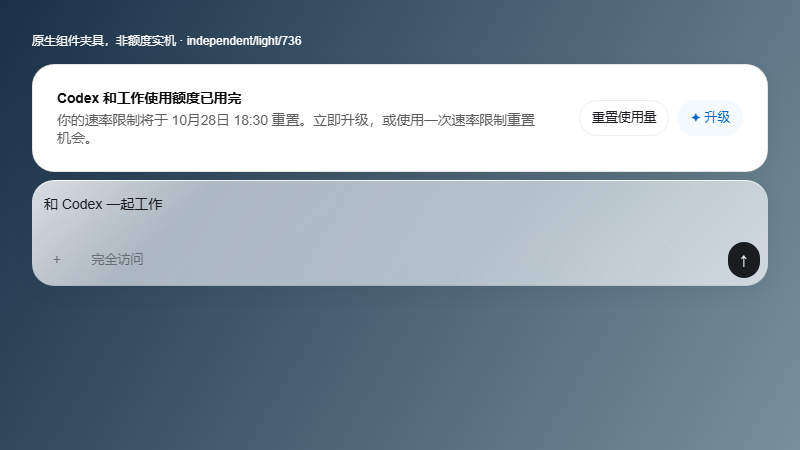

以上为真实原生渲染组件和 CSS 的独立浏览器夹具，使用示例文字与惰性按钮，**不是额度耗尽状态的实机截图**。来源见 [预览说明](docs/previews/README.md)，本轮内容见 [v0.18.7 发行说明](docs/RELEASE_0.18.7.md)，发布进度与正式下载见 [当前状态](docs/CURRENT_GOAL.md)。

## v0.18.6：设计控件弹层绘制范围

运行时 **v115-popover-paint-owner** 修正“设计控件”圆角外仍出现矩形背景的问题。原生 Popover 的 `data-slot="popover-content"` 也用于无底色的定位与缩放外壳，内层 FloatingSurface 才负责圆角和背景。主题现在依据实际背景载体替换材质：外壳保持透明，有原生表面底色的内容层绘制玻璃，避免两层背景叠加。

同时从原生代码排查共用组件的 20 处无样式调用，补齐头像反应选择器与内联结账面板的材质入口，保留头像原生滤镜、引导提示的反色文字与箭头，以及设计面板内部标题和控件的原生绘制。该排查属于源码核对，相关业务面板未逐一实机打开。

2026-10-18，用户验收后已发布 **[v0.18.6](https://github.com/Udkam/wukong-codex-theme/releases/tag/v0.18.6)**，并设为 GitHub Latest。精确发行源码 176 项回归及 Studio E2E 通过，同一正式 ZIP 完成本机恢复原生与重新注入，远程资产回下载哈希一致。v115 主页面读回背景就绪、窗口可见，样式与包内源码一致；完整结果见 [验证记录](docs/VALIDATION.md)。


以上为真实原生渲染组件与 CSS 的 **136×116 局部材质边界夹具**，**不是实机截图，也未复刻业务面板的控件布局**；来源和限制见 [预览说明](docs/previews/README.md)。用户验收与夹具来源分别记录，发布内容见 [v0.18.6 发行说明](docs/RELEASE_0.18.6.md)。

## v0.18.5：Dots 处理框标题材质修复

2026-10-18，运行时 **v114-summary-header-material** 已注入本机，核对客户端 **26.1013.4894.0**。修复 Dots 处理框顶部仍出现黑带的问题：任务标题、普通线程标题及资料收起标题的原生渐变现在从所在摘要面板取色，与面板底色一致。渐变及其透明度继续由原生控制，保留遮挡滚动文字的作用；原生布局、返回与打开聊天按钮继续生效。

已按用户授权发布 [v0.18.5](https://github.com/Udkam/wukong-codex-theme/releases/tag/v0.18.5)。深浅模式实机检查、独立源码 173 项回归、Studio E2E、同包恢复与注入及远程哈希校验均已完成，详细范围见 [验证记录](docs/VALIDATION.md)。回归直接执行当前安装包的共享标题组件，并核验 portal 和隐藏包装层的真实归属，覆盖普通渐变、动态透明度和实色底板，减少遗漏处理框变体的情况。


预览来自真实客户端，标题临时替换为“示例任务”，消息滚动区仅隐藏绘制，截图后均恢复。当前任务内容没有可滚动范围，实机检查不包含长列表滚动；滚动和遮挡行为由原生组件夹具覆盖。完整来源见 [预览说明](docs/previews/README.md)，本轮范围见 [发行说明](docs/RELEASE_0.18.5.md)。

## v0.18.4：新版底部背景、代码块与浏览器修复

运行时 **v113-native-footer-paint** 已注入本机，核对客户端 **26.1013.4894.0**。本轮按用户明确授权随 v0.18.4 运行包发行。新版把普通对话和 Dots 的底部绘制迁移到共享背景组件，本轮按实际装饰节点处理渐变、实色和组合三种状态，清除输入框后方黑边，保留原生尺寸、滚动预留和交互。

同时适配默认代码块的新 CodeSurface 与吸顶工具栏，继续保护预览、悬浮和用户消息代码的原生绘制。本轮还合并了浏览器 portal 堆叠修复：取消 #root 的正 z-index，使原生网页视图恢复显示。


预览来自当前客户端，截图时临时隐藏消息及草稿内容的绘制，截图后恢复。实机、原生源码与夹具结果分别记录在 [验证记录](docs/VALIDATION.md)；更多预览来源见 [预览说明](docs/previews/README.md)。

### 本轮合并的浏览器显示修复

客户端把浏览器网页挂载到 body 下，位于应用根节点之外。旧主题给 #root 添加 z-index: 1，将已加载的网页盖住。保留相对定位并取消该层级抬高后，网页恢复显示。专项原生来源和验证边界见 [浏览器修复说明](docs/BROWSER_PORTAL_FIX.md)。

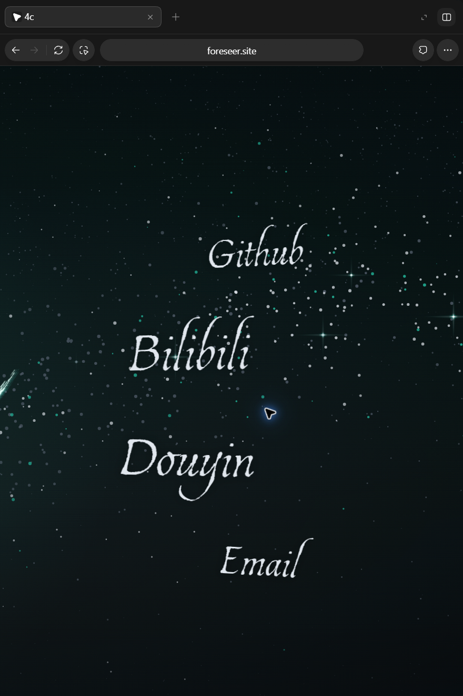

截图仅包含公开网页和浏览器工具栏；浏览器专项的深浅自动夹具结果与深色实机结果分别记录。

为 Windows ChatGPT/Codex 桌面客户端提供悟空背景与玻璃材质，支持深浅色主题。保留原生交互，按区域替换材质；10 张战斗图、3 张风景图，对话默认雪山。

## v0.18.3：Dots 标题渐变修复

2026-10-08，运行时 **v111-dots-header-owner**，核对客户端 **26.1002.7124.0**。Dots 页面顶部的黑色／白色遮带来自原生浮动标题的装饰渐变，旧选择器只识别了另一种背景类。本版改为按动态标题锚点、空节点和无障碍装饰状态识别绘制层，覆盖通过 portal 移出的标题背景，保留头像、资料入口、通话按钮及原生滚动布局。


本版预览来自真实客户端，不包含私人聊天正文。深浅模式下已检查顶部、中部、底部滚动及资料开关状态；回归保护同时检查安装包中的真实标题结构与原生 CSS，并在语义接口变化时要求重新核对，减少仅靠旧夹具通过检查却遗漏当前组件的情况。实际检查范围与发行结果见 [验证记录](docs/VALIDATION.md) 和 [发行说明](docs/RELEASE_0.18.3.md)。

## v0.18.2：搜索与共用浮层修复

2026-10-08，运行时 **v110-command-surface-owner**，核对客户端 **26.1002.7124.0**。搜索聊天、文件搜索和共用命令列表现在由实际内容根节点绘制玻璃，透明定位外框保持原生；同时补齐 Popover、确认和专用语音选择器的组件背景。搜索使用更浓的深浅色阅读底色，保留原生键盘导航、列表滚动和尺寸。

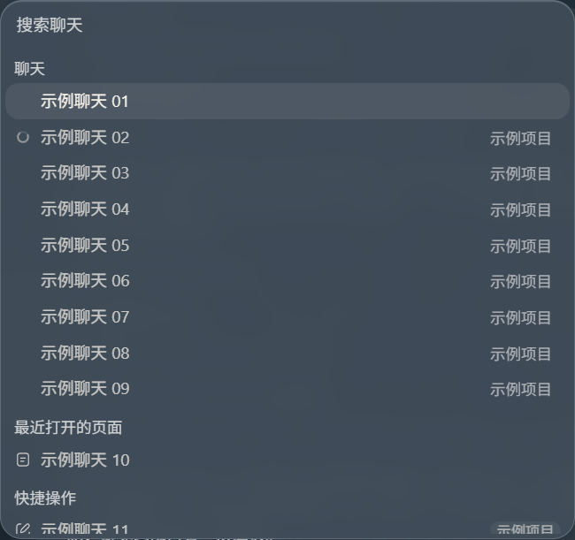

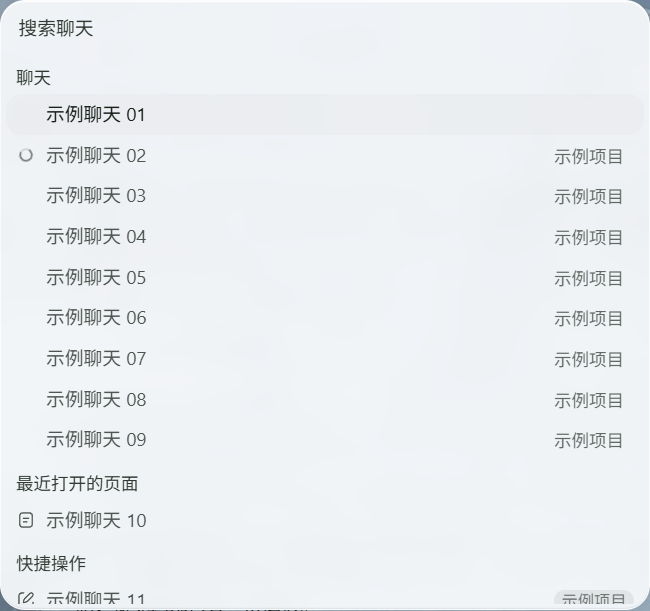

预览来自真实客户端，列表标题已临时脱敏为示例文字；截图后恢复。修复已完成本机检查并按用户授权随 v0.18.2 运行包发行。范围和证据见 [验证记录](docs/VALIDATION.md) 与 [发行说明](docs/RELEASE_0.18.2.md)。

## v0.18.1：浮动输入框边缘修正

2026-10-06，运行时 **v109-floating-paint-owner**。核对客户端 **26.930.4958.0** 的右下角快速聊天组件：原生圆角类同时用于定位外框和实际背景层。主题现只替换原生带底色的背景层，避免透明外框被重复绘制成厚边，保留原生尺寸、位置、圆角和展开交互。本轮已注入本机，随 v0.18.1 运行包发行。

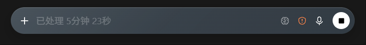

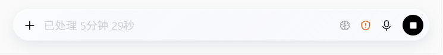

当前修正的检查记录见 [验证记录](docs/VALIDATION.md)，发行说明见 [RELEASE_0.18.1.md](docs/RELEASE_0.18.1.md)。

## v0.18.0：原生表面适配重构

**v0.18.0（2026-10-04，运行时 v108）** 对照 Windows Codex **26.930.3930.0** 的原生 UI，集中维护容器识别和材质配置。本版运行包包含本轮适配与修复。

- **容器随原生变化：** 优先按 `data-*` 所属关系识别壁纸、侧栏、输入区、进度区和摘要面板，减少对固定尺寸、工具类组合及文案的依赖。
- **主题功能继续保留：** 背景队列、自动场景切换、锁定、前后切换、题字开关、深浅玻璃和设置往返复用均保留。
- **材质可配置：** 主题 JSON 的 `materials.dark/light` 可调整玻璃填充、模糊、导航与阅读颜色；已有 schemaVersion 3 导出仍可加载。
- **添加面板：** 分组标题、提示文字与滚动内容使用一致材质，保持原生选择、禁用、滚动和键盘操作。
- **权限表与 dots：** 浏览器智能体权限表使用配套深浅色底色，保留固定列和横向翻页；dots 输入区后方的装饰渐变已清除。
- **清理现役源码：** 移除失效注入方案、旧纹理、历史截图断言与重复说明；仍有效的回归保护迁移到当前结构。Git 历史及已发布版本保留。

### 基础适配预览（v0.18.0）

以下为 2026-10-04 的基础适配新聊天页和局部截图；后续版本的修复预览按版本列于上方。新聊天页的侧栏名称已临时替换为示例文本，截图后立即恢复；预览不包含聊天正文。完整来源、模式和验证边界见 [预览说明](docs/previews/README.md)。

**深色**

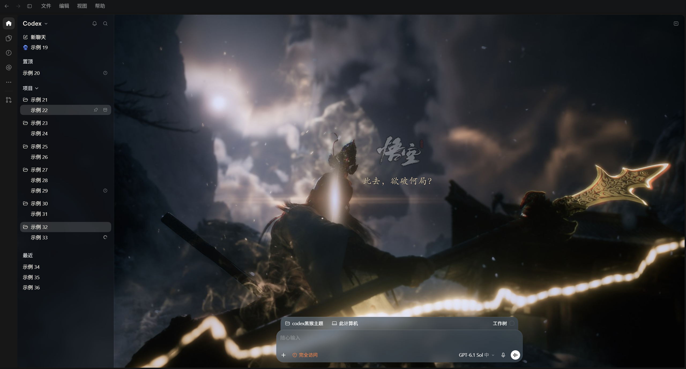


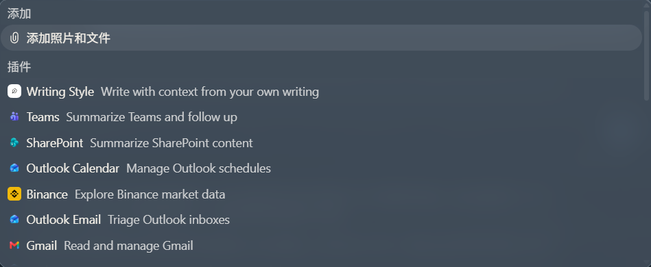

**浅色**

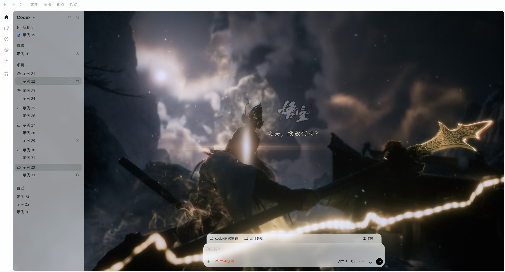


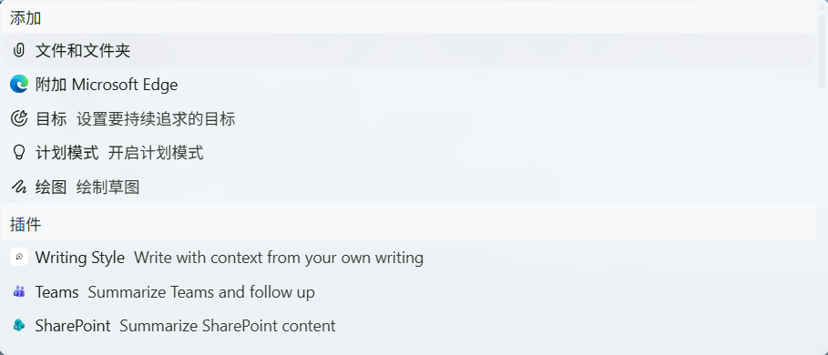

详细设计见 [原生表面与材质接口](docs/native-surface-adaptation.md)，实机与自动检查结果见 [验证记录](docs/VALIDATION.md)。原生组件若更换语义接口，仍需维护映射；本轮减少的是替换代码对布局细节的依赖。
## 开始使用

需要已安装的官方 Windows 桌面客户端，无需另外安装 Node.js、Python 或 npm。

1. 下载 [v0.18.6 Windows 运行包](https://github.com/Udkam/wukong-codex-theme/releases/download/v0.18.6/Wukong-Codex-Theme-0.18.6-Windows.zip)。请选择此运行包，GitHub 自动生成的 **Source code** 是开发源码。
2. 完整解压到固定文件夹。首次启动前，完全退出 ChatGPT/Codex，包括系统托盘实例。
3. 双击 **start.cmd**。

新的下载包结构：

```text
Wukong-Codex-Theme/
├─ start.cmd       ← 双击这里
├─ 使用说明.txt
└─ app/           ← 必要运行文件，无需打开
```

请保留整个文件夹，不要只复制 start.cmd，也不要直接在压缩包内运行。可为 start.cmd 创建桌面快捷方式。

当前正式版本为 **v0.18.6**，已设为 GitHub Latest。完整操作说明见 [快速开始](docs/QUICK_START.txt)，发行结果见 [当前状态](docs/CURRENT_GOAL.md)。

## 常用操作

| 操作 | 快捷键 |
| --- | --- |
| 下一张 / 上一张 | Ctrl+Alt+F / Ctrl+Alt+B |
| 切换战斗 / 风景组 | Ctrl+Alt+C |
| 锁定 / 解锁背景 | Ctrl+Alt+K |
| 显示 / 隐藏新对话题字 | Ctrl+Alt+T |

新对话使用战斗组，对话和项目页使用风景组。背景不会定时自动轮播。

## 没有出现主题？

- **应用已经开着：** 从系统托盘完全退出，再双击 start.cmd。已有普通进程无法补加主题启动参数。
- **找不到客户端：** 先安装并正常打开一次官方桌面客户端。
- **启动报错：** 错误窗口会保留，复制内容到 [Issues](https://github.com/Udkam/wukong-codex-theme/issues)。
- **恢复原生：** 完全退出后，从官方入口启动 ChatGPT.exe。

主题不修改官方安装文件、账号配置或自动更新策略。start.cmd 每次启动重新查找已安装版本；未来客户端若改变注入接口，仍可能需要主题适配。关闭主题启动的应用后，可删除解压目录；已有账户数据不由主题卸载操作清理。

## 源码与开发

仓库中的 start.cmd 也可直接使用。runtime、scripts、shared、themes 是运行与开发文件；用户下载包会把它们集中到 app 内。

- [开发、测试与打包](docs/DEVELOPMENT.md)
- [文件结构](docs/FILE_INVENTORY.md)
- [原生表面与材质接口](docs/native-surface-adaptation.md)
- [验证记录](docs/VALIDATION.md)
- [资源来源](docs/ASSET_SOURCES.md)

仓库当前分支仅保留主题。宠物制作资料、旧诊断和 Archives 存档已退出当前源码和运行包；本轮复查旧归档与旧待删除目录均已不存在；新产生且删除受阻的重复副本已另行集中供手动删除。历史迁移与本机清理记录见 [清理记录](docs/CLEANUP.md)。
