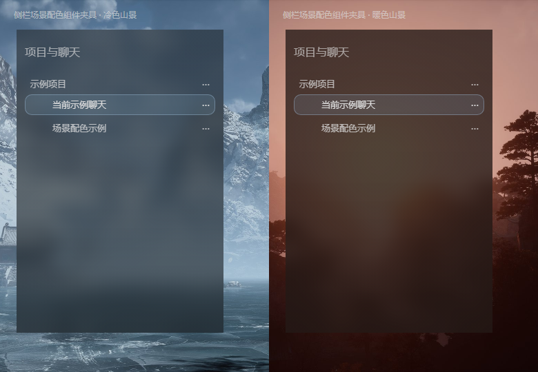
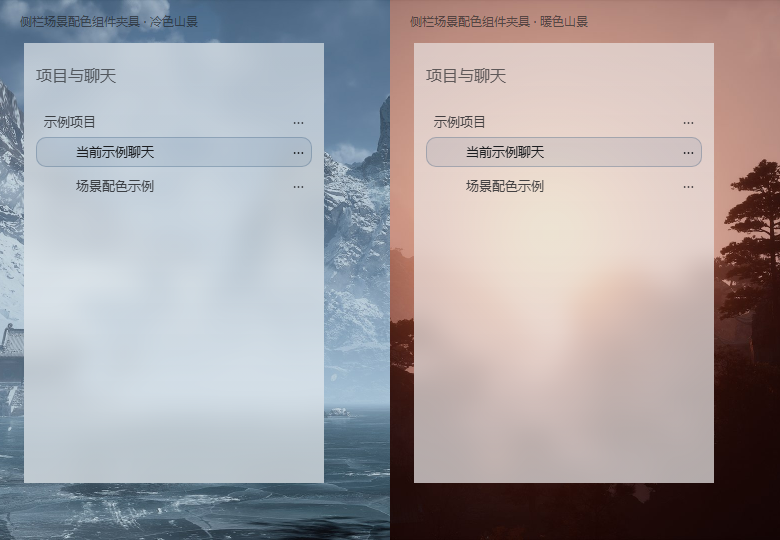

# Wukong Codex Theme

为 Windows Codex / ChatGPT 桌面客户端带来悟空背景与玻璃材质，支持深色和浅色主题。内置 10 张战斗图与 3 张风景图，可用快捷键切换。

**[下载 Windows 运行包](https://github.com/Udkam/wukong-codex-theme/releases/download/v0.18.14/Wukong-Codex-Theme-0.18.14-Windows.zip)** · [使用说明](docs/QUICK_START.txt) · [更新记录](https://github.com/Udkam/wukong-codex-theme/releases)

## 效果预览

悟空场景与深浅玻璃材质，侧栏随实际壁纸取色。项目条间歇横线的开发调整见[开发说明](docs/RELEASE_NEXT.md)，更多效果见[组件预览](docs/previews/README.md)。

| 深色 | 浅色 |
| :---: | :---: |
|  |  |

预览使用 Windows Codex 26.1117.4957.0 的原生结构、样式与示例内容生成，属于组件夹具；具体变化见 [发行说明](docs/RELEASE_0.18.14.md)，检查与实机验收情况见 [验证记录](docs/VALIDATION.md)。

## 开始使用

需要 Windows 和已安装的官方桌面客户端，无需另装 Node.js、Python 或 npm。

1. 下载上方 Windows 运行包，完整解压到固定文件夹。
2. 完全退出 Codex / ChatGPT，包括系统托盘中的后台实例。
3. 双击解压目录中的 **start.cmd**。

保留整个解压目录；日常使用主题时也从 start.cmd 启动。背景切换等快捷键见 [使用说明](docs/QUICK_START.txt)。

恢复原生界面：完全退出应用，再从官方入口启动。

---

[开发文档](docs/DEVELOPMENT.md) · [当前发行说明](docs/RELEASE_0.18.14.md) · [验证记录](docs/VALIDATION.md) · [问题反馈](https://github.com/Udkam/wukong-codex-theme/issues)
